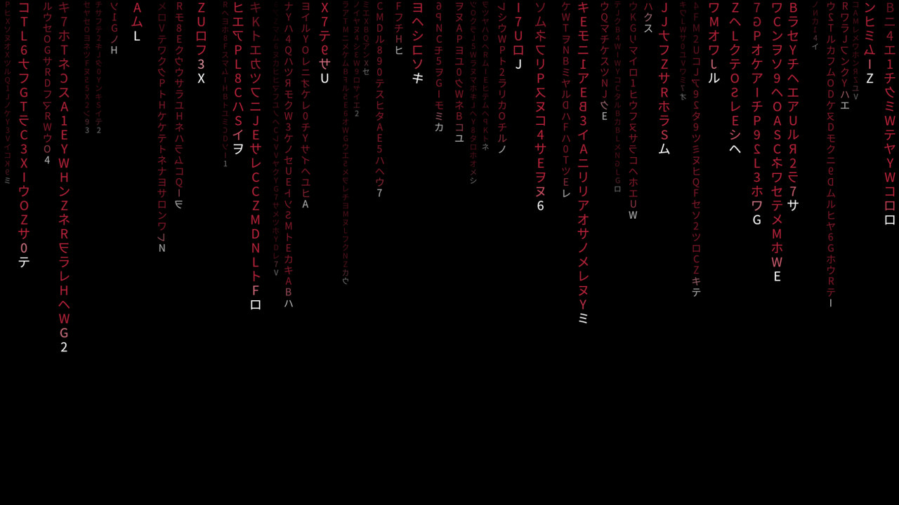
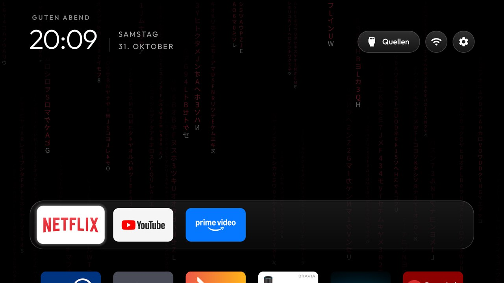
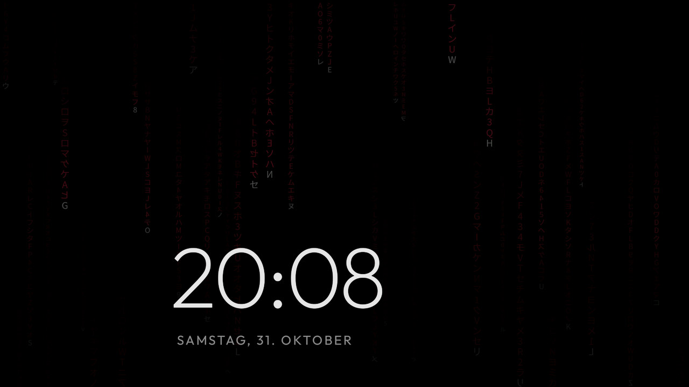

# Red Rain Matrix: a power-on intro for the CleanYourTV launcher

A fork of [CleanYourTV](https://github.com/Gathin23/cleanyourtv)'s launcher that adds one thing: a few seconds of
red "digital rain", a fan-made replica of the falling code from The Matrix, every time the TV wakes from standby
and on the first Home after a boot, then Home. It ships with the `red-rain-matrix` theme: the same rain frozen as
the wallpaper, the cinematic frosted-glass dock and the clock screensaver over the rain, so the intro fades into
a Home that looks like its last frame.

| Intro (TV waking up) | Home | Clock screensaver |
|---|---|---|
|  |  |  |

Tested on a Sony BRAVIA KD-43XF7596 (`BRAVIA_ATV3_4K_EU`, MediaTek MT5891), on Android TV 8.0 and, after the
firmware update, Android TV 9 (`PTT1.190515.001.S54`). Screenshots are from that TV.

## What it adds

- `MatrixRainView` draws the rain with OpenGL ES 2: one texture atlas of glyphs, every glyph a quad, one draw call
  a frame. Columns of katakana, letters and digits (some mirrored) on three depth layers with their own size,
  brightness and speed; each drop has a white head and a trail that fades towards its top, and lit cells change
  their glyph now and then. About 45 to 55 fps on the MT5891; the first version, drawn with `Canvas.drawText`,
  managed 19.
- `MatrixIntroActivity` shows it for `matrix_intro_seconds`, fades to black and opens Home. Any key skips it; if
  another app takes the screen first (the TV's own wake-up input, say) it closes and stays closed.
- `MatrixIntro` starts it on `ACTION_SCREEN_ON` (a receiver registered by Home while the launcher runs, not in
  the manifest) and once per boot (`Settings.Global.BOOT_COUNT`), read from the theme's `config.json`.
- No new permission, no network, no service. With `matrix_intro` off (the default) no receiver is registered and
  nothing new runs.
- The APK is about 592 KB, over the upstream size gate (576 KB), which is why this lives in a fork and not in the
  core launcher.

## Theme keys

Set in a theme's `config.json`, next to the usual keys. `themes/red-rain-matrix/config.json` turns the intro on.

| Key | Type | Default | What it does |
|---|---|---|---|
| `matrix_intro` | bool | `false` | The intro on wake and on the first Home of a boot |
| `matrix_intro_seconds` | 2 to 15 | `5` | How long it runs, the fade included |
| `matrix_intro_color` | `"#RRGGBB"` | `"#D63C54"` | The rain's colour; the theme uses `#B52239` |
| `matrix_intro_speed` | 0.3 to 2 | `1` | Fall speed; the theme uses `0.85` |
| `matrix_intro_entry_seconds` | 0 to 5 | `1.6` | Over how long the first drops enter from the top |

## Build and install

The same as upstream (JDK 17, Android SDK 34), from this branch:

```bash
cd launcher && ./build-and-install.sh            # or launcher\build-and-install.ps1 -TvHost <tv ip>
TV_HOST=<tv ip> tools/theme.sh themes/red-rain-matrix
```

To make the launcher's clock the TV's screensaver too, so standby shows the clock over the rain rather than the
stock one: `settings put secure screensaver_components com.gathin.tvhome/.ClockDream`.

## Credits

Built on CleanYourTV by Gathin23 and contributors (MIT). The wallpaper is drawn from code and released under
CC0 (see `themes/red-rain-matrix/CREDITS.md`); the glyphs come from Noto Sans CJK JP (SIL OFL 1.1), the font
Android TV ships. "The Matrix" is a trademark of Warner Bros.; this is a fan-made look and is not affiliated with
or endorsed by its owners. Fork by [rotkppchn](https://github.com/rotkppchn).
